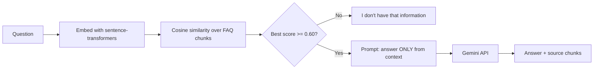

# Loan FAQ Assistant (RAG)

A retrieval-augmented question-answering app. It answers only from a small sample
FAQ and refuses questions the FAQ cannot answer.

**Demo:** [loan-faq-rag.streamlit.app](https://loan-faq-rag.streamlit.app/) (free tier; it may take a minute to wake up)

## How it works



1. `chunking.py` splits the FAQ into sentence-based chunks.
2. `retrieve.py` embeds chunks and finds the closest ones to the question.
3. A similarity threshold blocks clearly unrelated questions before any LLM call.
4. `answer.py` sends the retrieved chunks to the LLM with a grounded prompt.
5. `app.py` shows the answer and the sources used.

## Evaluation

Corpus: 16 sample sentences I wrote. Test set: 20 in-scope and 10 off-topic
questions I wrote, so these numbers show the pipeline works on a small sample.
They do not predict performance on real documents.

| Metric | Result |
|---|---|
| Retrieval hit@1 (20 in-scope questions) | 95% |
| Retrieval hit@3 | 100% |
| Off-topic questions refused end to end | 10 of 10 |
| In-scope questions answered correctly (one run) | 19 of 20 |

- **Threshold:** 0.60, chosen from a 0.30 to 0.80 sweep. It keeps 100% of in-scope
  questions and blocks 60% of off-topic ones by score alone. The grounded prompt
  refused the remaining near-topic traps (car loan, home loan, savings account).
- **Model comparison:** MiniLM and BGE both scored 95% hit@1. Score scales differ
  between models (off-topic scores reached 0.75 with BGE), so a threshold tuned for
  one model failed on the other and had to be retuned.
- **Prompt change:** asking for one complete sentence and only the requested fact
  removed three style problems (bare "Yes", a fragment, an unrelated extra fact)
  without changing the 19 of 20 score.
- **Known failure:** "What proof of address is required?" The FAQ names the
  requirement but never lists accepted documents, so the model said it didn't know.

## Limitations

- Tiny sample corpus; the same person wrote the data and the questions.
- The threshold was tuned on the same questions it was measured on.
- LLM output varies between runs.

## Run locally

```bash
pip install -r requirements.txt
export GEMINI_API_KEY="your-key"     # Windows PowerShell: $env:GEMINI_API_KEY="your-key"
streamlit run app.py
```

Never commit your API key.